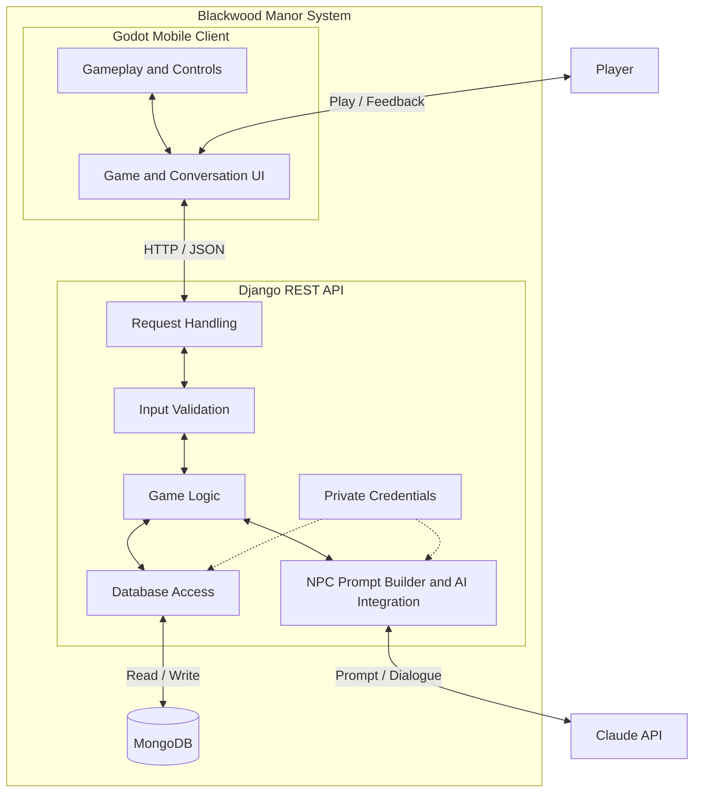

# CSC325_CAPSTONE

## Group Members:

- Ethan Mikucki
- Jeffery Jean
- Fred Zhang
- Sean Wallace
- Angel Mendez Reyes
- John Rosario Castro

## Description:

Murder Mystery Game (title subject to change)

Project Overview:

MMG is an interactive mystery-solving application developed for our CSC325 Software Engineering course at Farmingdale State College.

Players will investigate a murder case by exploring locations, collecting evidence, interviewing suspects, and using clues to determine who committed the crime.

The goal is to create an engaging detective experience where players use logical reasoning and critical thinking to solve a mystery.

## Setup Guide

### Manual Process

Run every command from the repository root (the folder containing `README.md`)
unless a step says otherwise. For Atlas access, dialogue testing, and
troubleshooting, see the full backend guides for [macOS](backend/SETUP_MAC.md)
and [Windows](backend/SETUP_WIN.md).

#### 1. Prerequisites

- Python **3.14** ([python.org](https://www.python.org/downloads/)). On Windows, check "Add Python to PATH" during installation.
- Git
- A MongoDB Atlas connection string and database credentials from the project administrator, shared privately
- For live NPC replies: a Claude API key and a model ID. These aren't needed to run the backend's health check or automated tests.

#### 2. Install Godot 4.7.2

- macOS: [download Godot 4.7.2](https://downloads.godotengine.org/?version=4.7.2&flavor=stable&slug=macos.universal.zip&platform=macos.universal), unzip it, and move `Godot.app` to your Applications folder.
- Windows: [download Godot 4.7.2](https://downloads.godotengine.org/?version=4.7.2&flavor=stable&slug=win64.exe.zip&platform=windows.64) and extract the zip. `Godot_v4.7.2-stable_win64.exe` runs without installing.

#### 3. Create and activate the virtual environment

macOS:
```bash
python3.14 -m venv .venv
source .venv/bin/activate
```

Windows (PowerShell):
```powershell
python -m venv .venv
.\.venv\Scripts\Activate.ps1
```

If PowerShell says running scripts is disabled, run
`Set-ExecutionPolicy -Scope Process -ExecutionPolicy RemoteSigned` in the same
terminal and activate again. Your prompt should now start with `(.venv)`.
You only create `.venv` once; activate it in every new terminal.

#### 4. Install the Python packages

With the virtual environment active:
```bash
python -m pip install --upgrade pip
python -m pip install -r backend/requirements.txt
python -m pip check
```

The last command should report `No broken requirements found.`

#### 5. Create `backend/.env`

Copy the example file. Skip this if you already have a `backend/.env`, because it would overwrite your settings.

- macOS: `cp backend/.env.example backend/.env`
- Windows: `Copy-Item backend/.env.example backend/.env`

Open `backend/.env` in your editor and fill in each value:

| Key | Value |
| --- | --- |
| `DJANGO_SECRET_KEY` | A generated key, wrapped in single quotes (see below) |
| `DJANGO_DEBUG` | `True` for local development |
| `MONGODB_URI` | Your Atlas connection string, with the username and password filled in |
| `MONGODB_DATABASE` | `murder_mystery_dev` (the shared development database) |
| `ANTHROPIC_API_KEY` | Your Claude API key, or leave the placeholder if you don't need live dialogue |
| `ANTHROPIC_MODEL` | A Claude model ID available to your account |

Generate a secret key with the virtual environment active:
```bash
python -c "from django.core.management.utils import get_random_secret_key; print(get_random_secret_key())"
```

Paste it as `DJANGO_SECRET_KEY='the-generated-key'`. Never commit `backend/.env`; it is already in `.gitignore`.

#### 6. Start the backend

With the virtual environment active:
```bash
cd backend
python manage.py check
python manage.py migrate
python manage.py runserver
```

Open http://127.0.0.1:8000/api/health/. It should show `{"status":"ok"}`.
Stop the server with `Control+C` (macOS) or `Ctrl+C` (Windows).

#### 7. Run the game

- Open Godot and click **Import**.
- Choose `game/project.godot` from this repository.
- Press F5 on Windows or Cmd+B on macOS to run the project.

### Automatic Process

We have a simple bash and powershell script that will automate the entire setup of the project (for both Windows and MacOS). Please see the respective guides if you wish to have the entire process automated.

This will consist of the following:

- Downloading Godot
- Setting up the virtual environment
- Downloading `requirements.txt` packages
- Setting up the .env file

Before you run a script:

- Install Python 3.14 first. The scripts set up the virtual environment but don't install Python.
- If you want to fill in `.env` from the prompts, have your Atlas connection string and Claude API key ready.

What the scripts ask:

- **Godot:** Download, Skip (if you already have Godot 4.7.2), or Exit.
- **Virtual environment** and **.env file:** each asks `Do you wish to continue? [y/N]`, so you can skip either one.
- **.env values:** press Enter to keep the value shown in brackets, or enter `1` to leave it blank. For `DJANGO_SECRET_KEY`, pressing Enter generates a new key.
- If `backend/.env` already exists, the script asks before overwriting it.

When the script finishes, it prints the commands to start the backend.

#### PowerShell Script Setup (Windows):

- Open the project directory in a terminal
- Run the following command to install project prerequisites:
```pwsh
powershell -ExecutionPolicy Bypass -File .\install-prereqs.ps1
```
- Start the backend:
```pwsh
.\.venv\Scripts\Activate.ps1
cd backend
python manage.py check
python manage.py migrate
python manage.py runserver
```
- Open Godot
- Import `game/project.godot`
- Press F5 to run the project

#### Bash Script Setup (MacOS):

- Open the project directory in a terminal
- Make install-prereqs.sh executable && run the script:
```bash
chmod +x install-prereqs.sh && ./install-prereqs.sh
```
- Start the backend:
```bash
source .venv/bin/activate
cd backend
python manage.py check
python manage.py migrate
python manage.py runserver
```
- Open Godot
- Import `game/project.godot`
- Press Cmd+B to run the project

## Backend development

- [Windows setup](backend/SETUP_WIN.md)
- [macOS setup](backend/SETUP_MAC.md)
- [NPC dialogue API contract and Godot handoff](backend/docs/dialogue-api.md)

The local dialogue MVP supports one predefined NPC with Claude-generated replies.
The backend owns NPC data, validation, prompts, and Claude access. The Godot client
owns the conversation UI and supplies recent history with each message.

## Architecture

Our project will use a client–server architecture with a layered backend. The Godot client will handle gameplay, player controls, and the user interface. It will communicate with a Django REST API through HTTP requests. The backend will separate request handling, input validation, game logic, and database access. Different endpoints will support features such as NPC dialogue, player progress, collected clues, and game sessions. MongoDB will store persistent game data, while the backend will communicate with Claude to generate NPC responses. This design follows separation of concerns, making each part easier to develop, test, and maintain. API keys and database credentials will stay on the backend.

## System Architecture



Solid two-way arrows represent requests and responses. Dotted arrows show private configuration used by the backend. Database access uses the MongoDB Django Backend; private credentials include the database credentials and Claude API key.

## Test Plan

We plan to use three categories of testing:

- Unit testing: Test individual functions, such as validating player input, checking clue unlock conditions, and building NPC prompts. External services will be mocked to keep tests predictable.
- Integration testing: Check that API endpoints, game logic, and MongoDB work together correctly. Tests will cover saving and loading progress, retrieving clues, and handling database or AI service failures. Database tests will use a separate test database.
- System testing: Test complete workflows in Godot, such as interviewing an NPC, collecting evidence, and continuing a saved game. We will check normal gameplay, invalid actions, and connection failures against the project’s requirements.
