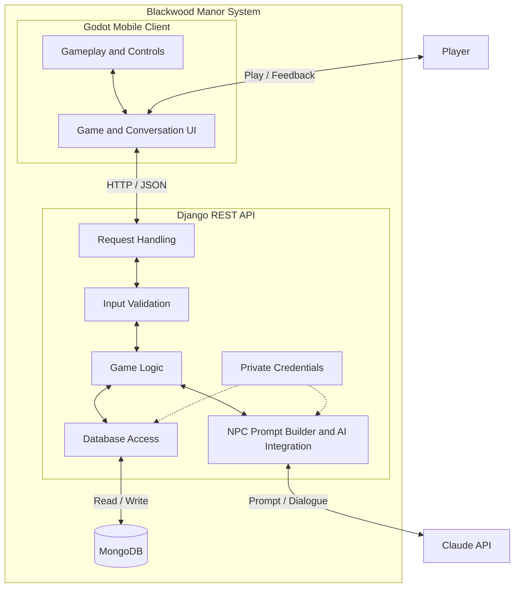

# CSC325_CAPSTONE

## Group Members:

- Ethan Mikucki
- Jeffery Jean
- Fred Zhang
- Sean Wallace
- Angel Mendez Reyes
- John Rosario Castro

## Description:

Murder Mystery Game (title subject to change)

Project Overview:

MMG is an interactive mystery-solving application developed for our CSC325 Software Engineering course at Farmingdale State College.

Players will investigate a murder case by exploring locations, collecting evidence, interviewing suspects, and using clues to determine who committed the crime.

The goal is to create an engaging detective experience where players use logical reasoning and critical thinking to solve a mystery.

## Backend development

- [Windows setup](backend/SETUP_WIN.md)
- [macOS setup](backend/SETUP_MAC.md)
- [NPC dialogue API contract and Godot handoff](backend/docs/dialogue-api.md)

The local dialogue MVP supports one predefined NPC with Claude-generated replies.
The backend owns NPC data, validation, prompts, and Claude access. The Godot client
owns the conversation UI and supplies recent history with each message.

## Architecture

Our project will use a client–server architecture with a layered backend. The Godot client will handle gameplay, player controls, and the user interface. It will communicate with a Django REST API through HTTP requests. The backend will separate request handling, input validation, game logic, and database access. Different endpoints will support features such as NPC dialogue, player progress, collected clues, and game sessions. MongoDB will store persistent game data, while the backend will communicate with Claude to generate NPC responses. This design follows separation of concerns, making each part easier to develop, test, and maintain. API keys and database credentials will stay on the backend.

## System Architecture

Solid two-way arrows represent requests and responses. Dotted arrows show private configuration used by the backend. Database access uses the MongoDB Django Backend; private credentials include the database credentials and Claude API key.

## Test Plan

We plan to use three categories of testing:

- Unit testing: Test individual functions, such as validating player input, checking clue unlock conditions, and building NPC prompts. External services will be mocked to keep tests predictable.
- Integration testing: Check that API endpoints, game logic, and MongoDB work together correctly. Tests will cover saving and loading progress, retrieving clues, and handling database or AI service failures. Database tests will use a separate test database.
- System testing: Test complete workflows in Godot, such as interviewing an NPC, collecting evidence, and continuing a saved game. We will check normal gameplay, invalid actions, and connection failures against the project’s requirements.
