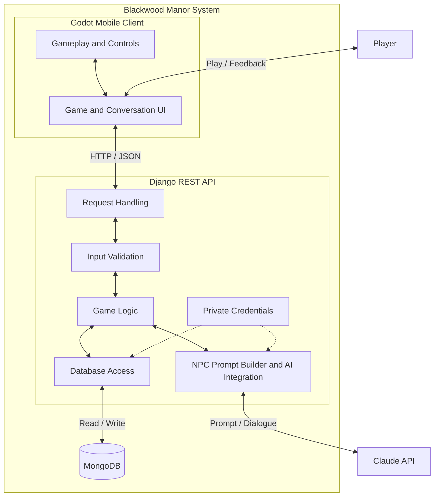

# CSC325_CAPSTONE

## Group Members:

- Ethan Mikucki
- Jeffery Jean
- Fred Zhang
- Sean Wallace
- Angel Mendez Reyes
- John Rosario Castro

## Description:

Murder Mystery Game (title subject to change)

Project Overview:

MMG is an interactive mystery-solving application developed for our CSC325 Software Engineering course at Farmingdale State College.

Players will investigate a murder case by exploring locations, collecting evidence, interviewing suspects, and using clues to determine who committed the crime.

The goal is to create an engaging detective experience where players use logical reasoning and critical thinking to solve a mystery.

## Backend development

- [Windows setup](backend/SETUP_WIN.md)
- [macOS setup](backend/SETUP_MAC.md)
- [NPC dialogue API contract and Godot handoff](backend/docs/dialogue-api.md)

The local dialogue MVP supports Claude-generated replies from MongoDB-backed NPC profiles.
The backend owns NPC data, conversation history, validation, prompts, and Claude access.
The dialogue API uses a playthrough ID and NPC ID to load recent exchanges.

## Architecture

Our project will use a client–server architecture with a layered backend. The Godot client will handle gameplay, player controls, and the user interface. It will communicate with a Django REST API through HTTP requests. The backend will separate request handling, input validation, game logic, and database access. Different endpoints will support features such as NPC dialogue, player progress, collected clues, and game sessions. MongoDB will store persistent game data, while the backend will communicate with Claude to generate NPC responses. This design follows separation of concerns, making each part easier to develop, test, and maintain. API keys and database credentials will stay on the backend.

## System Architecture



Solid two-way arrows represent requests and responses. Dotted arrows show private configuration used by the backend. Database access uses the MongoDB Django Backend; private credentials include the database credentials and Claude API key.

## Test Plan

We plan to use three categories of testing:

- Unit testing: Test individual functions, such as validating player input, checking clue unlock conditions, and building NPC prompts. External services will be mocked to keep tests predictable.
- Integration testing: Check that API endpoints, game logic, and MongoDB work together correctly. Tests will cover saving and loading progress, retrieving clues, and handling database or AI service failures. Database tests will use a separate test database.
- System testing: Test complete workflows in Godot, such as interviewing an NPC, collecting evidence, and continuing a saved game. We will check normal gameplay, invalid actions, and connection failures against the project’s requirements.

## CI/CD pipeline

The workflow in [.github/workflows/ci-cd.yml](.github/workflows/ci-cd.yml) runs on
every branch push and every pull request targeting `main`. It has two jobs:
**Build-Test-Deploy** for the backend and **Game-Test** for the Godot client.

Build-Test-Deploy has four named stages implemented as workflow steps:

| Stage | Behavior |
| --- | --- |
| Setup | Checks out the repository and configures Python 3.14 with pip caching. |
| Dependencies | Installs `backend/requirements.txt` and runs `pip check`. |
| Test | Runs Django system checks and the backend automated tests. |
| Deploy | After successful tests on a push to `main`, prints `Deploying... (placeholder; no deployment configured)`. |

Deploy is skipped for feature branches and pull requests. A failed setup,
dependency installation, or test prevents the Deploy step from running.
**The Deploy step is a placeholder: no backend is hosted or deployed yet.**
The job has read-only repository permissions and a ten-minute timeout.

Game-Test runs alongside it, with the same permissions and timeout:

| Stage | Behavior |
| --- | --- |
| Setup | Checks out the repository and downloads Godot 4.7.2, cached between runs. |
| Import | Runs `godot --headless --import` to build the import cache, which is not committed. Fails if any script has an error. |
| Test | Runs every scene named `game/tests/<name>_test.tscn` headless. A test scene exits with a non-zero code when a check fails. |
| Room data check | Runs `python tools/build_rooms.py --check` when that script is present. |

### Run CI checks locally

Install Python 3.14 and create and activate a virtual environment using the
[Windows](backend/SETUP_WIN.md) or [macOS](backend/SETUP_MAC.md) setup guide.
Then, from the repository root:

```sh
cd backend
python -m pip install -r requirements.txt
python -m pip check
python manage.py check --settings=config.settings_ci
python manage.py test --settings=config.settings_ci --verbosity 2
```

Run these commands from `backend` so Django discovers the tests. CI settings
generate an ephemeral Django key, disable debug mode, and use a local MongoDB
address without credentials. The default suite mocks Claude and skips the MongoDB
integration tests, so it runs without either service. To run the MongoDB integration
tests, start a local MongoDB instance on port 27017, set `RUN_MONGODB_TESTS=1`,
and run `python manage.py test dialogue --settings=config.settings_ci`.
Django uses a disposable test database on that instance.

For the game, install Godot 4.7.2 and run from the repository root:

```sh
godot --headless --path game --import
godot --headless --path game res://tests/<name>_test.tscn
```

Run the import first on a fresh clone. Run the second command once for each test
scene in `game/tests`; it exits with a non-zero code if a check fails.

## Main Branch Protection

**Status: Active — GitHub branch protection ruleset created.**

The `main` branch is protected using a GitHub ruleset configured under **Settings > Rules > Rulesets**.

### Branch Protection Configuration

The ruleset includes the following protections:

1. **Require pull requests:** All changes to `main` must go through a pull request rather than a direct push.
2. **Required approvals:** At least **1 approval** from an eligible teammate is required before merging.
3. **Dismiss stale approvals:** New commits pushed to a pull request dismiss previous approvals.
4. **Required status checks:** GitHub Actions checks must pass before merging. The intended required checks are `Build-Test-Deploy` and `Game-Test`.
5. **Branch synchronization:** Pull requests should be up to date with `main` before merging.
6. **Block force pushes:** Force pushes to `main` are prohibited.
7. **Restrict deletions:** The protected branch cannot be deleted by users without bypass permission.
8. **Bypass permissions:** No bypass exceptions should be configured.

The **Restrict updates** option remains disabled to allow normal pull request merges after all requirements are satisfied.

### Verification
- Pull requests trigger the GitHub Actions CI/CD workflow.
- A successful `Build-Test-Deploy` workflow run was observed on Pull Request #57.

**Ruleset:** [Main Branch Protection](https://github.com/ethanmiku/CSC325_CAPSTONE/rules/27001007)

**Reference:** [GitHub Ruleset Documentation](https://docs.github.com/en/repositories/configuring-branches-and-merges-in-your-repository/managing-rulesets/creating-rulesets-for-a-repository)

## Secrets

Never commit API keys, tokens, passwords, or populated `.env` files. The repository
ignores `.env` and `.env.*`, while tracking `.env.example` with placeholders.
Ignoring a file does not remove credentials from earlier commits.

During this implementation, a pattern scan of 79 locally reachable commits
(371 unique file blobs) found no matches for common Anthropic, GitHub, AWS,
credential-bearing MongoDB URI, or generated Django development-key patterns.
This is a limited check, not proof that the history contains no secrets.

The current workflow needs **no stored secrets**. Before adding real deployment,
store credentials under **Settings > Secrets and variables > Actions** and
reference them through GitHub's `secrets` context. Backend credentials include
`DJANGO_SECRET_KEY`, `MONGODB_URI`, and `ANTHROPIC_API_KEY`; securely provision them
to the future runtime. Never pass production credentials to PR tests or print
secret values in logs. `ANTHROPIC_MODEL` and `MONGODB_DATABASE` are configuration,
not credentials.

If a credential is discovered in history, revoke or rotate it immediately and
coordinate any history cleanup with the team. Pattern scans cannot prove that
all possible secrets are absent.

## Teammate pull request workflow and sanity check

After obtaining repository write access, a teammate can:

1. Clone `https://github.com/ethanmiku/CSC325_CAPSTONE.git` and follow the local
   CI commands above; production credentials are not needed to run tests.
2. Create a feature branch with `git switch -c your-feature-name`.
3. Make changes, run checks, commit, and push with
   `git push -u origin your-feature-name`.
4. Open a PR targeting `main` and inspect the **Build-Test-Deploy** and **Game-Test** checks in the PR's Checks tab.
5. Address failures and request a teammate's review. Once the ruleset is active,
   passing tests and approval are required before merging.
6. After merging, open **Actions > Backend & Godot CI/CD** and inspect the run for `main`.
   It repeats the tests and executes the placeholder Deploy step.

**Sanity-check status:** local tests pass. GitHub workflow execution and ruleset
enforcement still need verification after pushing. Real deployment is pending,
so the assignment's requirement to see a running deployment is not yet satisfied.

## AI-use statement

We used both OpenAI Codex and Claude Code to inspect Godot and Django backend, 
draft the GitHub Actions workflow, add isolated CI settings, run checks, and 
document the PR process.During local validation, an initial test invocation from 
the repository root discovered zero tests. Running from `backend` discovered and 
passed all 34 tests; the workflow and instructions explicitly use that directory 
to avoid a misleading successful run with no tests. No failure in a live GitHub 
Actions run has been observed yet; this statement should be updated if further 
issues are found there. The team chose a placeholder Deploy step, and AI 
documented that it performs no actual deployment. Branch rules and real deployment
must not be represented as completed until verified.
